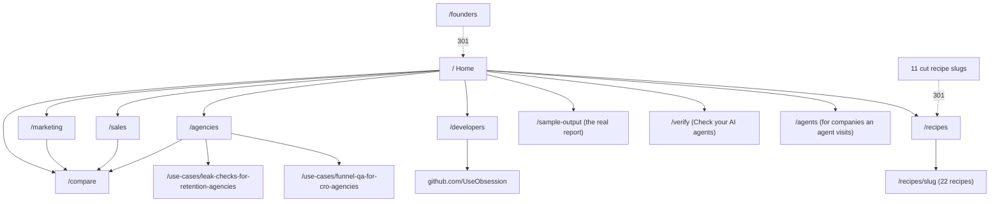

# Obsession website: the October rewrite

This file is the plan behind the copy and the design of useobsession.com after the October 2026 rewrite. The words themselves live in `src/content` (one file per page, plus `src/content/shared5.ts` for the blocks more than one page shows). When this file and a content file disagree, the content file is what ships; fix this file.

Inputs: `obsession/system.md` (the product, written as built), `docs/positioning/voc.md` (124 buyer quotes), `docs/positioning/competitors.md` (what 13 companies say and show, read on 18 Oct 2026), and James's brief: simpler, clearer, no technical cards on Home, written as if everything is built, every section and page connected, the reader grid kept but rebroken, a comparison table, and open source in the story.

Contents

1. Voice of customer
2. Competitive messaging matrix
3. Positioning brief
4. Message hierarchy
5. Content inventory: keep, merge, cut
6. Sitemap and reading paths
7. Copy deck
8. Claims register
9. Design plan
10. Validation plan
11. Open items

---

## 1. Voice of customer

Full sheet: `docs/positioning/voc.md` (102 outside quotes from Capterra, G2 via SaaSworthy, Trustpilot, Hacker News and vendor pages, plus 22 from the call with Jamie on 12 Oct). Reddit was blocked for every tool, so it is missing.

**The 5 lines that shaped the copy**

| # | Quote | Who | What we took |
|---|---|---|---|
| 1 | "my options were to manually sign up for thousands of newsletters, hire a VA to do it, or try to cobble together some overly complicated AI process." | Panoramata user, Capterra UK | The old way is a person with a spare inbox. The gap block says so in their words. |
| 2 | "Before I was jumping between the Meta Ad Library manually subscribing to newsletters from competitors, screenshotting things, etc." | Panoramata user | "A spare inbox, screenshots and a spreadsheet" is the alternative we name on every reader page. |
| 3 | "What I don't in theory see is abandoned baskets. Order confirmation, any of this stuff" | Jamie | What only a customer gets: the basket reminder, the triggered email, not the newsletter. |
| 4 | "It allows me to prove that they've got a problem that is solvable." | Jamie | Proof is the buyer's job for a seller to brands; the receipt is the product's device. |
| 5 | "I get an alert every day with the subject "Important Change to the Site XXX" I open the email to find the body reads "no changes were made to this page"" | Visualping user, Trustpilot | Facts, not alerts: each finding is 1 sentence with what sits behind it. |

**Words buyers use, so the site uses them:** competitor emails; sign up; newsletters; abandoned basket; welcome email; Promotions tab; keep an eye on; in one place; manually; battlecards (B2B only); report to the client (agencies); leak (agencies: Email Kong calls its audit a leak report, 21 Oct).

**Customer in headlines, sign up in lines (19 Oct):** "customer" is the differentiator (MailCharts' own pitch is "we signup, trigger, collect"), so headlines name the identity; buyers say "sign up", so the line under it names the act.

**Words buyers never use, so the site explains or avoids them:** burner email, teardown, secret shopper, persona, lifecycle, AI agent (buyer voice), facts, proof. "Receipt" is the brand's one device, so it always sits beside the plain word: "every email, offer and price, with proof". "Fact" appears only in the developer blocks, where it is an API object.

**Words we keep off the site:** spy, swipe file, inspiration, autopilot (the direct competitors own them, and "spy" cuts against trust).

**Forces of progress (Moesta), as the copy answers them**

| Force | What buyers say | Where the site answers |
|---|---|---|
| Push | Collecting by hand doesn't scale; the tool misses the brand they need; archives miss triggered email and inbox placement | Home gap block; every reader gap block |
| Pull | Pull up any company and see what it sends, in seconds; be told only when something material changes; domain in, evidence out | Home hero; how it works ("It wakes and files the receipt"); the ways in |
| Anxiety | Price and plan gating; accuracy; will anyone keep using it | FAQ ("What do I get back?", "How do I check a fact is real?"); the real report |
| Habit | Spare inbox, Google Drive folders, Meta Ad Library, check twice a year | Comparison column "By hand"; /compare "When you might want something else" |

**Top jobs, in buyer order:** watch what competitors send by email; get told when a page changes; keep battlecards current; track prices; see new ads; build a swipe file; find prospect evidence for outbound; produce client reports; check inbox placement; trigger and capture flows. The marketing page leads with the first; sales leads with briefs and battlecards; agencies with the pitch and the client report.

---

## 2. Competitive messaging matrix

From `docs/positioning/competitors.md`, 18 Oct 2026. Their own words, then the line the site uses against each.

| Company | Their claim | What they actually keep | Our line beside them |
|---|---|---|---|
| Foreplay | "The Complete Winning Ad Workflow" | Ads from the ad libraries, saved for good, with a picture of the landing page; API and MCP; from $59 a month | "Foreplay saves the ad. Obsession follows its link as a customer and keeps going." |
| Panoramata | "The best way to track your competitors" | Newsletters, flows, ads, landing pages, SMS, socials for the competitors on your plan; MCP on its feature list; from $99 a month | "They keep what a company sends to its list. Obsession becomes a customer of any company you name." |
| MailCharts (Validity) | "Email and SMS Campaign Intelligence" | Signs up to and triggers journeys of 2,500+ hand picked brands | Same as Panoramata, plus "any company, the day you name it". |
| Milled | "The largest search engine for e-commerce emails." | 52.8M newsletters from about 103,000 brands since 2012 | "Search the archive there. Be the customer here." |
| Visualping | Page change alerts | The pages you choose, and an alert when they change | "An alert says a page changed. A fact says what changed for a customer." |
| Klue, Crayon | Competitive enablement | News, site changes, reviews, reps' notes, battlecards | "Battlecards built on what a customer of each rival actually gets." |
| Exa | "The world's data for AI agents" | Search over the public web | "Exa searches the web. Obsession is the customer." |
| Browserbase | "Give your agents access to the whole web." | Cloud browsers for as long as your code runs | "Browserbase drives a browser. Obsession is a customer that stays for months." |
| Grep, Archil | Agent harness; storage and sandboxes for agents | Infrastructure for agents | Design references, not rivals. Grep's dated comparison and Archil's "When you might want something else" shaped /compare. |

**White space no one claims** (competitors.md section 5): "be a customer" on demand for any company; receipts from private channels that prove themselves; patience (still there in month three); one thread from the ad to the inbox; an open source core in a closed category.

---

## 3. Positioning brief (April Dunford's 5 parts)

- **Competitive alternatives:** a person with a spare inbox, screenshots and a spreadsheet; ad libraries (Foreplay, the Meta Ad Library); email archives (Panoramata, MailCharts, Milled); page monitors (Visualping); competitive intelligence platforms (Klue, Crayon); for builders, Exa and Browserbase plus their own glue.
- **Unique attributes:** a long lived customer agent per company, with its own inbox, phone number and browser; it takes part (signs up, follows the ad, starts the trial, fills the basket, asks the bot); it sleeps for free and wakes when the company acts; every email is DKIM checked and timestamped; one shared record, so a company already watched has history on day one; 5 verbs over MCP, API and SDKs; an open source engine.
- **Value:** know what a company does to its customers, not what it publishes, without anyone signing up by hand, and prove it to a buyer, a client or a boss.
- **Who cares most:** marketing teams at brands watching rivals' emails and offers; agencies who pitch and report on clients; sales and GTM teams who need briefs and battlecards; developers and agent builders who need a customer at any company.
- **Market category:** the customer layer for agents. For buyers who don't build, it reads as "competitor tracking that is a customer, not an archive". The site never coins a new category word; it says what it is.
- **Relevant trend:** teams now work in Claude Code, Codex and the like. Those can reason, but what a company sends its customers was never on the web, so none of them can search for it (22 Oct: the ask section sells this as data you ask, not as the ways to connect).

---

## 4. Message hierarchy

**The one claim:** Be a customer of every company. Keep the receipts.

**The one sentence** (word for word on Home, llms.txt, the Organization JSON-LD and /agents): Obsession's AI agents sign up to any company you name and stay its customer for months, keeping every email, offer and price it sends, with proof.

**Three pillars, each with its proof on the page**

| Pillar | The line | Proof shown |
|---|---|---|
| It takes part | "Every tool shows you the ad. None of them is the customer." | The receipt stage: ad, page, email, receipt, for 3 example companies. The gap block's two lists. |
| It stays | "A customer that's still there in month three." | The agent's timeline: signs up Monday 09:00, wakes at 09:09, day 2, day 21, day 47, still a customer on day 90. |
| It proves it | "Keep the receipts." | Each receipt's DKIM line and stamp; the real September report; "Proof anyone can check" in the comparison. |

**Supporting messages, in reading order:** the commercial intelligence only a customer gets, asked from Claude Code, Codex or our website, every answer with its receipts (the ask section); other tools read the outside (the comparison); the engine is open source and the history is the cloud. The ways in (your own agent, a workflow file, code, our website) and the five verbs live on /developers.

**Rules of voice:** British English; no dashes; plain verbs; numbers as numerals in data, words in prose where natural; every company on a screen is invented, at a `.example` address (no "Example" tag on an illustration, James 19 Oct: the `.example` addresses and the invented names carry it); the only real result is the September store check and it says so; no now, next or later labels; no "never" rules except the three lines in system.md (the record, customer privacy, the law).

---

## 5. Content inventory: keep, merge, cut

| Before | Decision | After |
|---|---|---|
| Home hero: "The intelligence infrastructure for commercial teams", 5 tabs of app screens | Cut and replace | "Be a customer of every company. Keep the receipts.", the receipt stage |
| Home "how it works" rail (4 app slices) | Merge | The agent's timeline and 5 steps (shared with reader pages) |
| Home difference block (5 reader stories) | Cut | The gap block: what tools keep beside what a customer gets |
| Home recipe jobs (6 jobs) | Merge | "Be a customer of anyone": 3 kinds of company, each with its screen and recipes |
| Home "Check your AI agents" section | Merge | Third cell of the 3 kinds; /verify stays |
| Home "How our agents behave" row (6 rules) | Cut | The rules were self imposed; /agents carries the three lines |
| Reader band: 8 panels incl. Founders, Check your AI, Developers | Keep, rebreak | 4 panels: Marketing, Sales, Agencies, Developers |
| Founders page | Cut | 301 to / |
| 11 seller's representative recipes (account handover, business case, cancellation saves, client upsells, expansion offers, get paid, inbound quotes, renewal negotiation, review requests, software renewals, supplier quotes) | Cut | 301 to /recipes; sign up options that named them removed |
| 6 recipe jobs | Collapse | 3 groups: Watch other companies; Check your own journeys; Check your AI agents |
| Reader pages: hero console, How with 4 screens, Outcomes, Kinds, Recipes grid | Cut | Hero beside 1 screen, gap, use cases, how it works, comparison, real report, FAQ |
| Reader use case tabs | Keep, trim | 5 or 6 per page, cut recipes removed, self imposed rules taken out of the lines |
| Developers: How, Outcomes, Kinds, mission API | Replace | Gap, how it works, the ways in, the 5 verbs code, what developers build, open source |
| /compare | New | Full table, "When you might want something else", FAQ |
| /agents "never" list (8 rules) | Rewrite | The three lines only |
| Use case pages (/use-cases/...) | Rewrite | Rewritten 19 Oct in this voice: mystery shopping for ecommerce agencies ("Be a customer of every store you serve or pitch."; merged on 21 Oct into leak checks for retention agencies, "Be the new customer of every store you pitch, and every store you keep.", drawn in James's format from his pieces, its old address a 301), prospect intelligence with Clay ("Be a customer of every brand your client wants to win.") and member prices for price intelligence ("Be a customer of every retailer you track."). On 22 Oct a fourth joined, leak checks for ecommerce stores ("Be the new customer of your own store, every week and after every change."), drawn as the retention agencies page is; its copy and reviews are in `docs/copy/leak-checks-for-ecommerce-stores.md`. Later on 22 Oct a fifth, funnel QA for CRO agencies ("Be the new customer behind every pop up."), drawn the same way for the CRO agency founder or audit lead: what happens after a prospect's pop up before the pitch, and every test variant checked past the sign up after the win; its copy and reviews are in `docs/copy/funnel-qa-for-cro-agencies.md`. The last 2 stay James's own pages (`src/legacy/james`), his 3 stop hero flow kept with its words in line, and read their headline, sub, questions and small print from `content/usecases` |
| /verify | Light touch | Composition guarded; copy unchanged |

**One taxonomy everywhere** (nav, footer, /recipes, llms.txt, Home): the 3 recipe groups above, and 4 readers. `src/content/nav.ts` is the source; every surface reads it.

---

## 6. Sitemap and reading paths

**Home, top to bottom, each block answering the question the last one leaves:**

```mermaid
flowchart LR
  a["What is it? Hero and receipt stage"] --> b["Why can't my tools? The gap"]
  b --> c["How many, how soon? To know what 10,000 companies do, you have to be a customer of all 10,000"]
  c --> c2["Does it find anything? 93% of stores had a gap, 1 report in every format"]
  c2 --> d["Is it for me? Pick who you are"]
  d --> e["Of whom? Rivals, prospects, yourself, your AI"]
  e --> s["How does it scale? Learn it once, run it for 100,000"]
  s --> f["Versus what? The comparison"]
  f --> g["Where do I use it? The ways in"]
  g --> i["Can I trust it? Open source"]
  i --> j["Questions"] --> k["Join"]
```

**Scale, after grep.ai's two sections** ("Run it once. Run it 1,000 times. Run it 100,000 times." and "Learn once. Improve every run."), combined into one:
- Bound to scroll, never automatic. On a wide, tall screen the headline, stage and steps pin while the reader scrolls through 3 screens of track. The first third is step 1, then step 2, then step 3, and scrolling back goes back.
- The headline count follows the step: 1 company, then 1,000 companies, then 100,000 companies. The h2's label is the full sentence.
- Each step's bar fills with the scroll, and a step's tab scrolls to it. On a phone or a short screen the 3 steps stack, and the count follows the step in the middle of the screen.
- The 3 steps:
  1. An agent signs up at the first company and leaves a trace, saved as "newsletter sign up, v1". No platform is named (James, 19 Oct).
  2. The trace becomes a program, each step marked code, question, small agent or person, while 2 meters fall.
  3. A field of 400 squares (each 250 companies) fills square by square with the scroll, and the count climbs with it to 100,000. Scrolling back empties it.
- A step plays its small story as it becomes the current one; reduced motion shows each step finished.
- Under the stage: 3 principles, then the first store beside every store after, labelled illustrative as grep's is.

**Reader pages** follow one order: hero beside a screen, the gap in their words, their jobs as tabs, how it works, the comparison, the real report, their questions, the call to action. **Developers** swaps the jobs and comparison for the ways in, the code and open source.

---

## 7. Copy deck

The full words are in the content files; this is the spine of each page.

**Home** (`src/content/pages/home.ts`)

| Block | Headline | Line |
|---|---|---|
| Hero | Be a customer of every company. Keep the receipts. | Obsession's AI agents sign up to any company you name and stay its customer for months, keeping every email, offer and price it sends, with proof. |
| Stage | 3 examples: Fern Hollow (offer held), Larchwise (trial went quiet), Northfold (price cut on day 21) | Each: the ad, the page, the email, the receipt and its stamp |
| Gap | Every tool shows you the ad. None of them is the customer. | Tools stop at what is public, or archive newsletters from their own list of brands. What happens after the click only reaches a customer: either you with a spare inbox, screenshots and a spreadsheet, or an AI customer at every company you name. |
| How | To know what 10,000 companies do, you have to be a customer of all 10,000. | A list fanning out to many lanes on 1 axis from Monday 09:00 to day 90 (the hero's 3 companies named, "+ 9,997 more" faded), then 4 phases; phase 1 opens on **Any input:**. Breadth first, months as the payoff (3 reviews, 19 Oct) |
| Proof | 93% of stores we shopped on every journey had a gap. | Here is 1 of them: a basket and a checkout left, and no email in 48 hours. The September report in its 6 formats (PDF, Email, Slack, Sheet or Clay, JSON webhook, Workflow), kept small: the claim beside the viewer, a 400px stage; "See the full report". It replaced the formats grid on 19 Oct |
| Readers | Pick who you are. | 4 panels |
| Kinds | Be a customer of anyone. Rivals, prospects, or yourself. | 4 cards, 2 by 2: Rivals, Prospects and accounts, Your own journeys, Your AI agents |
| Ask | The commercial intelligence only a customer gets. (A small label above it: Rivals · Prospects · Clients · Your own business.) | 3 questions, 1 per reader, each asked somewhere else (Claude Code and Codex, each showing the 1 line that connects Obsession, then code) and answered with its receipts; what Obsession keeps for each company; where you can ask from. Replaced the ways in on 22 Oct (`docs/positioning/ask-section.md`) |
| Compare | Other tools read the outside. Obsession is the customer. | 6 columns, 7 rows, dated |
| Scale | Learn it once. Run it for 1 company, 1,000 or 100,000. | The count follows 3 steps on 1 stage (learns the way in, turns it into a program, runs at any scale); 3 principles. No cost card: what it costs us to run is internal (James, 19 Oct). Under the comparison since 22 Oct |
| Open source | An open source runtime for customer agents, built to run 100,000 at once. | The engine's 8 capabilities (fan out to 100,000, durable agents that sleep for free, learns once then runs as code, better with every run, tested before it ships, a record that proves itself, any model per job, built for agents to call) beside Obsession Cloud's 5 lines |
| FAQ | Before you join. | 7 questions |
| Final | Name a company. See what its customers get. | Waitlist |

**Shared blocks** (`src/content/shared5.ts`): the agent's life, the ask section's shared parts and its example questions, the ways in (/developers only), the comparison, open source. Written once; Home and the reader pages import them. The ask section sits directly above the comparison wherever the comparison shows; on Sales and Agencies, which don't show it, it sits after how it works.

**Marketing** (`pages/marketing.ts`): "Every rival email, offer and price, seen as their customer." Gap: "Your dashboards show what you sent. Only a customer sees what arrived." 5 tabs: Product marketing, Performance, Brand and AI search, Partnerships, Lifecycle (the Ecommerce tab went with the AI checkout test recipe, retired 22 Oct: James, too narrow). Final: the free store report.

**Sales** (`pages/sales.ts`): "Know what every account and rival does to its customers." Gap: "Your CRM knows what they told you. A customer knows what they do." 6 tabs: Account brief (started by the calendar), Battlecards, Lead leaks, Pilot proof, Account watch, Win back.

**Agencies** (`pages/agencies.ts`): "Check every client and prospect as their customer would." Gap: "Clients pay for what you find. Finding it is the unpaid part." 5 tabs: Win the pitch, Deliver for every client, Keep every client, Sell a new service, Mystery shop any client. Final: the free report.

**Developers** (`pages/developers.ts`): "Give your agents a customer at every company." Gap: "Signing up once is easy. Staying a customer of 10,000 companies is not." Code: lookup, becomeCustomer, notify, and the `fact.created` webhook. 4 tabs of what developers build.

**Compare** (`pages/compare.ts`): "Obsession compared with ad libraries, email archives and page monitors". The table, then "When you might want something else" (7 tools, each with when to pick it), 4 questions.

**Site** (`src/content/site.ts`): the one sentence; /recipes (3 groups); /agents (rewritten to the three lines); 404; llms.txt intro (names every recipe, the comparison and open source).

---

## 8. Claims register

Every claim a reader could check, where it is, and what stands behind it. "As built" means the site writes it as built, per James's brief, and system.md describes it.

| Claim | Where | Basis | Status |
|---|---|---|---|
| Agents sign up and stay a customer for months | Home hero, the sentence | system.md: the customer agent, "a long-lived customer of one company, asleep almost all the time" | As built |
| Each agent has its own inbox, phone number and browser | Home how, reader pages, /agents | system.md, connectors | As built |
| Sleeps for free; wakes when the company acts | Home how | system.md, durable waits | As built |
| Every email DKIM checked and timestamped | Stage receipts, gap, developers | system.md §2 | As built |
| The Gmail tab each email landed in | Stage, gap, compare | system.md evals: Workspace vs gmail.com placement | As built |
| A shared record: history on day one | Open source, FAQ "How soon" | system.md: shared pool and `lookup` | As built |
| 5 verbs over MCP, API and SDKs; TypeScript and Python | Ways, developers | system.md: "a REST API, SDKs and MCP"; languages chosen for the site | As built; languages to confirm |
| `claude mcp add obsession https://mcp.useobsession.com` | Ways, developers FAQ | Endpoint named for the site | As built; endpoint to stand up |
| Priced per call or per company, self serve keys with a cap | Developers FAQ, ways | system.md line 164 | As built |
| About 250 integrations | Open source | system.md, Integrations | As built |
| The runtime is open source (a runtime for customer agents, not a general harness); github.com/UseObsession | Open source, footer, developers | system.md, "Open source core, Obsession Cloud" | As built; the org and licence to set up (open question in system.md) |
| The engine's 8 capabilities: fan out to 100,000; hibernate and wake on mail, reply or clock; trace compiled to code, typed questions and small agents; escalations become the next program version; versions replayed on frozen evidence, facts re-derived; evidence by content hash, DKIM key kept; a model per job; typed verbs, webhooks, idempotency keys, spending caps | Open source (Home, developers) | system.md: the customer agent, Design rules for the engine, the compile and replay steps, the first build's boxes, What an agent needs that a human forgives | As built |
| 6¢ a company to sign up once, 1.4¢ a company a month to keep, at 100,000 | Removed from Home on 19 Oct (internal) | `docs/positioning/scale_model.py`: our modelled cost to run, not a price | Modelled; internal, not on the site |
| 93% of stores shopped on every journey had a gap | Home proof (back on 19 Oct, in the formats grid's place) | Real audits (Seun, 7 Oct) | Real |
| One program per platform; learned, compiled, replayed; code, typed questions, small agents, escalation | Home scale | system.md, Program row and the 4 kinds of step | As built |
| Sign ups 70% plain request, 25% replayed script, 5% agent; about 140,000 wakes a day; about 2 awake at once | Home scale stage | `docs/positioning/scale_model.py`, modelled on Cloudflare, Archil, Steel, Workspace and model prices read 19 Oct 2026 | Modelled; swap in measured numbers when system.md's evals report them |
| The September skincare store report: 4 test customers, 48 hours, 1 basket and 1 checkout left, 0 reminders | Proof on every reader page, llms.txt | The real run, /sample-output | Real |
| Every company on the stage and screens | Home, reader pages | Invented, `.example` addresses; no Example tag since 19 Oct | Example |
| Competitor facts (prices, counts, features) | /compare, competitors matrix | Each tool's own pages, 18 Oct 2026 (`docs/positioning/competitors.md`) | Checked on the date shown; Visualping, Klue and Crayon are described without numbers because their pages were not read |
| The comparison marks | Home, /compare | competitors.md section 3, by kind of tool | "Partly" defined under the table |
| Agents never use fake payment details, never get round a CAPTCHA, never click paid ads at volume, say they're AI to people | /agents, llms.txt, FAQ | system.md, the three lines | Policy |

---

## 9. Design plan

**Design read:** a B2B product landing for marketing, sales and agency leads plus developers, evidence first, in a quiet product language (Geist, Geist Mono, the design system's neutrals), with one memorable object. Dials: variance 6, motion 5, density 4.

**Accent, changed 19 Oct (twice), then removed:** the first accent, cobalt (#9cadff on dark), read as grep.ai's indigo. It went to green, then to the Agencies burgundy, and is now gone: the site is black and white. Colour means something specific here: a reader's hue says whose page it is, and green or red in an app screen says passed or failed. Everything else is ink, paper and inversion; Obsession's column in the comparison is inverted at its head. The scale section uses no accent at all, only ink.

**The one object:** the receipt. Paper in both themes, mono type, a torn bottom edge (a CSS mask), a stamp in the one accent. It appears in the hero, on the cloud's list in open source, and in the "what a customer gets" column. Everything around it stays on the design system's ground and hairlines.

**Tokens** (`src/styles/v5.css`, on top of the design system, never in place of it): `--v5-stamp` is ink (the page's own text colour), used only for proof: the stamp, the wake points, Obsession's column, a chosen tab. `--v5-paper` and its inks are the receipt's material.

**Layout:** left aligned throughout. The hero splits 5 and 7 columns, words then evidence; a reader page's hero shows the screen of its own first job. Sections stack their head (claim, then one line) above the object. The kinds of company are a bento of 3. The comparison is a real table that scrolls inside its own frame on a phone, with the row names held.

**Motion, one moment per screen:**
- The hero stage plays the next company's journey (cards land in order, the receipt prints, the stamp lands), and holds on hover, on focus, off screen, in a hidden tab and on Pause.
- The agent's timeline draws in once when it comes into view.
- Reduced motion: nothing moves; the stage changes company only on a click.

**Pre-flight checklist:** one accent; one radius scale; no centred hero; no eyebrow labels added; no emoji; buttons fit on one line; visible focus on tabs, buttons and the table frame; phone width with no sideways page scroll (checked at 375px); prerendered HTML is the first story at rest, so nothing on first paint waits for a script.

---

## 10. Validation plan

**Automatic, on every build**
- `npm run build`: types, lint, OG images, prerender checks (meta answer on the page, llms intro names every recipe, unique titles and descriptions, title and description lengths, no bracketed placeholders).
- `node scripts/lint-copy.mjs` (add `--strict` to fail the build): dashes, retired phrases (the old category line, cut recipe names, "template", /founders, "do business with other companies for you"), contradictions ("never click your ads"), American spellings.
  - Before the rewrite: 986 retired phrases, 2 contradictions, 13 spellings.
  - After: 1 retired (a code comment on a use case page, left as briefed), 0 contradictions, 12 spellings that are all code tokens or URLs (`catalog`, `organization` in a link).

**LLM comprehension test** (run on `dist/llms-full.txt` and the built pages by a model that has never seen the product): 12 questions (what it is, who it's for, what an agent does, what you get, how it differs from Foreplay and Panoramata, from Exa and Browserbase, use from Claude, what is open source, what it never does, the real result, how to start, the 3 recipe groups), 5 scores, 10 problems. **Pass:** questions 1, 2, 3, 4, 5, 7 and 8 answered correctly from the pages, and no contradiction between pages.

**First run, 19 Oct 2026:** questions 1 to 12 all answered from the pages (11 only partly: no prices), but FAIL on consistency, with 3 contradictions. Fixed the same day:
- "Keys are self serve" against "we'll set up your keys with you" (developers). Fix: keys open from the waitlist; every key has a spending cap.
- Written as built against "Join the waitlist" everywhere. Fix: a Home question, "How do I get access?", says access opens from the waitlist a team at a time.
- "None of them is the customer" against MailCharts signing up to its own index. Fix: the gap line names archives of a tool's own list of brands, and "a customer of the company you name".

Also fixed from its problem list:
- The screens said "Missions"; they now say "Watches".
- The webhook on the Outputs tab now has the same `fact.created` shape as the developer code.
- "It waits, for free" sat beside per company pricing; it now reads "using nothing while it sleeps".
- A question on shared agents ("Can other customers see what I watch?") was added.
- The comparison is no longer repeated on Sales and Agencies.
- The real report's headline is now the same on every page.

**Second run, after the recipe pages were rewritten:** the core questions were answered again, but the run failed on 6 tensions, most between the new pages and older lines left in recipe pages and screen captions. All 6 were fixed:
- Past emails: competitor tracking now says history runs from the first Obsession sign up, as Home does.
- "never replies" in 2 screen captions is now "replies off", a setting.
- Ad tracking reads the public ad libraries and opens each page from its link.
- Privacy: anyone can see that a company is covered, never who asked. Shared agents cover what any customer gets; your own settings run on an agent of your own.
- Free offer: agencies get 5 client stores; everyone else gets a first mystery shop.
- MailCharts signs up to its own index, and the comparison's "Partly" note says so.

**Third run, contradictions only, every page and all 23 recipes:** 7 found. 5 were fixed:
- email history now matches competitor tracking;
- the sample report no longer says every checkout stops before payment;
- "clicks through" is now "follows the ad's link";
- the outbound check's test prospects receive and reply;
- Prospect intelligence drafts an opener that your team edits.

2 remain, and both sit in the use case pages, which the brief left untouched. Those pages still carry the old rules: "No basket without the owner's OK" and "never staff" (agencies), "only with the brand's OK" (Clay), and "only with the retailer's OK" (member prices). The recipe pages now say these are the customer's settings. One edit to the 3 use case pages closes it. Closed 19 Oct: on the Clay and member prices pages the basket checks are plain options with no OK attached, and the questions say how far an agent goes is the reader's setting; the agencies page keeps 1 rule on purpose (Seun's), a client's store is shopped with the client's OK.

**With people** (5 to 8 per test; recruit from the waitlist and Jamie's network):

1. **5 second test** on Home's first screen. Ask: what does this company do; who is it for. Pass: 4 in 5 say some form of "signs up to companies as a customer and shows you what they send".
2. **First click test.** Tasks: "You want to see how this compares with Panoramata"; "You run an agency"; "You want to use it from Claude". Pass: 4 in 5 click Compare, Agencies, and the ways in (or Developers) first.
3. **Side by side** with Panoramata's and Foreplay's home pages, 30 seconds each. Ask: which would you try to see what a rival sends after someone signs up, and why. Pass: the majority pick Obsession and name "being the customer" or "after the click".
4. **Words check.** Show the hero and ask the reader to explain "receipt" in their own words. Pass: 4 in 5 say "proof" or "the actual email". If not, the hero sub carries "with proof" already; swap "Keep the receipts" for "Keep the proof" only if this fails.

---

## 11. Open items

- Stand up `github.com/UseObsession` and pick the licence (system.md lists it as an open question) before the open source block goes live.
- Stand up `mcp.useobsession.com` and confirm the SDK languages the site names.
- The sign up card (`src/content/signup.ts`) still has a "founder" role in its form contract; its options no longer name cut recipes, but the role itself is a waitlist field and was left for a separate change.
- `/verify` keeps its earlier copy; a pass to bring it to this voice is a separate change.
- Recipe pages keep their earlier copy apart from group names; several still describe self imposed rules ("never replies", "stops before payment").
- Visualping, Klue and Crayon facts on /compare are general; read their own pages and add dated specifics.
- James's 2 use case pages (`src/legacy/james`) now use the recipe pages' names and the October voice (19 Oct), but their hero flows and app windows still carry his own colours: a green live dot and red gap tags in the flows, a blue "new" (the member prices flow's "After sign up", the Clay columns, the members lane) and an amber "Only members saw it" tag. His recipe data keeps the old names ("Prospect research", "Speed to lead", "Price and promotion watch") in `content/recipes.ts` and `content/runs.ts`, which no page shows.
