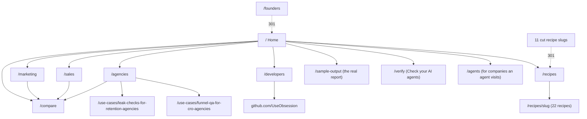

# Obsession website: the October rewrite, and the AI customer (3 Nov)

**3 Nov 2026, the AI customer.** James: "the whole shopper thing is a disservice and lack of understanding of the product". What Obsession sells is an **AI customer**: you send one to any company, it does what a real customer does (signs up, buys, talks to support, cancels, asks for the refund), and it keeps the receipts. Mystery shopping is one job it does, not the product. The hero moved from "Be a customer of every company. Keep the receipts." to **"See what any company shows only its customers."** (4 Nov evening: Seun's pick, "See what any company tells only its customers.", led every one of 10 rounds of simulated readers, and no line without a verb reached 6; "shows" replaced "tells", which 3 of 7 readers paused on in each round and which reads as messages only. Before it, the same day, "Intelligence on any company, from inside it.", which readers took for hacking and spy talk, and before that "Send an AI customer to any company.", too passive about the outcome), and every page, recipe and post was rewritten to the AI customer. The rules are in `docs/copy/ai-customer-voice.md`; where this file still shows an October line, the content files and that guide win.

This file is the plan behind the copy and the design of useobsession.com after the October 2026 rewrite. The words themselves live in `src/content` (one file per page, plus `src/content/shared5.ts` for the blocks more than one page shows). When this file and a content file disagree, the content file is what ships; fix this file.

Inputs: `obsession/system.md` (the product, written as built), `docs/positioning/voc.md` (124 buyer quotes), `docs/positioning/competitors.md` (what 13 companies say and show, read on 18 Oct 2026), and James's brief: simpler, clearer, no technical cards on Home, written as if everything is built, every section and page connected, the reader grid kept but rebroken, a comparison table, and open source in the story.

Contents

1. Voice of customer
2. Competitive messaging matrix
3. Positioning brief
4. Message hierarchy
5. Content inventory: keep, merge, cut
6. Sitemap and reading paths
7. Copy deck
8. Claims register
9. Design plan
10. Validation plan
11. Open items

---

## 1. Voice of customer

Full sheet: `docs/positioning/voc.md` (102 outside quotes from Capterra, G2 via SaaSworthy, Trustpilot, Hacker News and vendor pages, plus 22 from the call with Jamie on 12 Oct). Reddit was blocked for every tool, so it is missing.

**The 5 lines that shaped the copy**

| # | Quote | Who | What we took |
|---|---|---|---|
| 1 | "my options were to manually sign up for thousands of newsletters, hire a VA to do it, or try to cobble together some overly complicated AI process." | Panoramata user, Capterra UK | The old way is a person with a spare inbox. The gap block says so in their words. |
| 2 | "Before I was jumping between the Meta Ad Library manually subscribing to newsletters from competitors, screenshotting things, etc." | Panoramata user | "A spare inbox, screenshots and a spreadsheet" is the alternative we name on every reader page. |
| 3 | "What I don't in theory see is abandoned baskets. Order confirmation, any of this stuff" | Jamie | What only a customer gets: the basket reminder, the triggered email, not the newsletter. |
| 4 | "It allows me to prove that they've got a problem that is solvable." | Jamie | Proof is the buyer's job for a seller to brands; the receipt is the product's device. |
| 5 | "I get an alert every day with the subject "Important Change to the Site XXX" I open the email to find the body reads "no changes were made to this page"" | Visualping user, Trustpilot | Facts, not alerts: each finding is 1 sentence with what sits behind it. |

**Words buyers use, so the site uses them:** competitor emails; sign up; newsletters; abandoned basket; welcome email; Promotions tab; keep an eye on; in one place; manually; battlecards (B2B only); report to the client (agencies); leak (agencies: Email Kong calls its audit a leak report, 21 Oct).

**Customer in headlines, sign up in lines (19 Oct):** "customer" is the differentiator (MailCharts' own pitch is "we signup, trigger, collect"), so headlines name the identity; buyers say "sign up", so the line under it names the act.

**Words buyers never use, so the site explains or avoids them:** burner email, teardown, secret shopper, persona, lifecycle, AI agent (buyer voice), facts, proof. "Receipt" is the brand's one device, so it always sits beside the plain word: "every email, offer and price, with proof". "Fact" appears only in the developer blocks, where it is an API object.

**Words we keep off the site:** spy, swipe file, inspiration, autopilot (the direct competitors own them, and "spy" cuts against trust).

**Forces of progress (Moesta), as the copy answers them**

| Force | What buyers say | Where the site answers |
|---|---|---|
| Push | Collecting by hand doesn't scale; the tool misses the brand they need; archives miss triggered email and inbox placement | Home gap block; every reader gap block |
| Pull | Pull up any company and see what it sends, in seconds; be told only when something material changes; domain in, evidence out | Home hero; how it works ("It wakes and files the receipt"); the ways in |
| Anxiety | Price and plan gating; accuracy; will anyone keep using it | FAQ ("What do I get back?", "How do I check a fact is real?"); the real report |
| Habit | Spare inbox, Google Drive folders, Meta Ad Library, check twice a year | Comparison column "By hand"; /compare "When you might want something else" |

**Top jobs, in buyer order:** watch what competitors send by email; get told when a page changes; keep battlecards current; track prices; see new ads; build a swipe file; find prospect evidence for outbound; produce client reports; check inbox placement; trigger and capture flows. The marketing page leads with the first; sales leads with briefs and battlecards; agencies with the pitch and the client report.

---

## 2. Competitive messaging matrix

From `docs/positioning/competitors.md`, 18 Oct 2026. Their own words, then the line the site uses against each.

| Company | Their claim | What they actually keep | Our line beside them |
|---|---|---|---|
| Foreplay | "The Complete Winning Ad Workflow" | Ads from the ad libraries, saved for good, with a picture of the landing page; API and MCP; from $59 a month | "Foreplay saves the ad. Obsession follows its link as a customer and keeps going." |
| Panoramata | "The best way to track your competitors" | Newsletters, flows, ads, landing pages, SMS, socials for the competitors on your plan; MCP on its feature list; from $99 a month | "They keep what a company sends to its list. Obsession becomes a customer of any company you name." |
| MailCharts (Validity) | "Email and SMS Campaign Intelligence" | Signs up to and triggers journeys of 2,500+ hand picked brands | Same as Panoramata, plus "any company, the day you name it". |
| Milled | "The largest search engine for e-commerce emails." | 52.8M newsletters from about 103,000 brands since 2012 | "Search the archive there. Be the customer here." |
| Visualping | Page change alerts | The pages you choose, and an alert when they change | "An alert says a page changed. A fact says what changed for a customer." |
| Klue, Crayon | Competitive enablement | News, site changes, reviews, reps' notes, battlecards | "Battlecards built on what a customer of each competitor actually gets." |
| Exa | "The world's data for AI agents" | Search over the public web | "Exa searches the web. Obsession is the customer." |
| Browserbase | "Give your agents access to the whole web." | Cloud browsers for as long as your code runs | "Browserbase drives a browser. Obsession is a customer that stays for months." |
| Grep, Archil | Agent harness; storage and sandboxes for agents | Infrastructure for agents | Design references, not competitors. Grep's dated comparison and Archil's "When you might want something else" shaped /compare. |

**White space no one claims** (competitors.md section 5): "be a customer" on demand for any company; receipts from private channels that prove themselves; patience (still there in month three); one thread from the ad to the inbox; an open source core in a closed category.

---

## 3. Positioning brief (April Dunford's 5 parts)

- **Competitive alternatives:** a person with a spare inbox, screenshots and a spreadsheet; ad libraries (Foreplay, the Meta Ad Library); email archives (Panoramata, MailCharts, Milled); page monitors (Visualping); competitive intelligence platforms (Klue, Crayon); for builders, Exa and Browserbase plus their own glue.
- **Unique attributes:** a long lived customer agent per company, with its own inbox, phone number and browser; it takes part (signs up, follows the ad, starts the trial, fills the basket, asks the bot); it sleeps for free and wakes when the company acts; every email is DKIM checked and timestamped; one shared record, so a company already watched has history on day one; 5 verbs over MCP, API and SDKs; an open source engine.
- **Value:** know what a company does to its customers, not what it publishes, without anyone signing up by hand, and prove it to a buyer, a client or a boss.
- **Who cares most:** marketing teams at brands watching competitors' emails and offers; agencies who pitch and report on clients; sales and GTM teams who need briefs and battlecards; developers and agent builders who need a customer at any company.
- **Market category:** the customer layer for agents. (5 Nov: the company's category is the index of what companies send their customers; the customer layer for AI agents is the developer product line under it, as Google Cloud is under Google.) For buyers who don't build, it reads as "competitor tracking that is a customer, not an archive". The site never coins a new category word; it says what it is.
- **Relevant trend:** teams now work in Claude Code, Codex and the like. Those can reason, but what a company sends its customers was never on the web, so none of them can search for it (22 Oct: the ask section sells this as data you ask, not as the ways to connect).

---

## 4. Message hierarchy

**The one claim:** See what any company shows only its customers. (Until 4 Nov evening: Intelligence on any company, from inside it. Until 3 Nov: Be a customer of every company. Keep the receipts.)

**The one sentence** (word for word on Home, llms.txt, the Organization JSON-LD and /agents): Obsession sends AI customers to any company you name. Each one signs up, buys, talks to support and stays for months, keeping every email, offer, price and reply it gets, with proof.

**Three pillars, each with its proof on the page**

| Pillar | The line | Proof shown |
|---|---|---|
| It takes part | "Every tool shows you the ad. None of them is the customer." | The receipt stage: ad, page, email, receipt, for 3 example companies. The gap block's two lists. |
| It stays | "A customer that's still there in month three." | The agent's timeline: signs up Monday 09:00, wakes at 09:09, day 2, day 21, day 47, still a customer on day 90. |
| It proves it | "Keep the receipts." | Each receipt's DKIM line and stamp; the real September report; "Proof anyone can check" in the comparison. |

**Supporting messages, in reading order:** the commercial intelligence only a customer gets, asked from Claude Code, Codex or our website, every answer with its receipts (the ask section); other tools read the outside (the comparison); the engine is open source and the history is the cloud. The ways in (your own agent, a workflow file, code, our website) and the five verbs live on /developers.

**Rules of voice:** British English; no dashes; plain verbs; numbers as numerals in data, words in prose where natural; every company on a screen is invented, at a `.example` address (no "Example" tag on an illustration, James 19 Oct: the `.example` addresses and the invented names carry it); the only real result is the September store check and it says so; no now, next or later labels; no "never" rules except the three lines in system.md (the record, customer privacy, the law).

---

## 5. Content inventory: keep, merge, cut

| Before | Decision | After |
|---|---|---|
| Home hero: "The intelligence infrastructure for commercial teams", 5 tabs of app screens | Cut and replace | "Be a customer of every company. Keep the receipts.", the receipt stage |
| Home "how it works" rail (4 app slices) | Merge | The agent's timeline and 5 steps (shared with reader pages) |
| Home difference block (5 reader stories) | Cut | The gap block: what tools keep beside what a customer gets |
| Home recipe jobs (6 jobs) | Merge | "Be a customer of anyone": 3 kinds of company, each with its screen and recipes |
| Home "Check your AI agents" section | Merge | Third cell of the 3 kinds; /verify stays |
| Home "How our agents behave" row (6 rules) | Cut | The rules were self imposed; /agents carries the three lines |
| Reader band: 8 panels incl. Founders, Check your AI, Developers | Keep, rebreak | 4 panels: Marketing, Sales, Agencies, Developers |
| Founders page | Cut | 301 to / |
| 11 seller's representative recipes (account handover, business case, cancellation saves, client upsells, expansion offers, get paid, inbound quotes, renewal negotiation, review requests, software renewals, supplier quotes) | Cut | 301 to /recipes; sign up options that named them removed |
| 6 recipe jobs | Collapse | 3 groups: Watch other companies; Check your own journeys; Check your AI agents |
| Reader pages: hero console, How with 4 screens, Outcomes, Kinds, Recipes grid | Cut | Hero beside 1 screen, gap, use cases, how it works, comparison, real report, FAQ |
| Reader use case tabs | Keep, trim | 5 or 6 per page, cut recipes removed, self imposed rules taken out of the lines |
| Developers: How, Outcomes, Kinds, mission API | Replace | Gap, how it works, the ways in, the 5 verbs code, what developers build, open source |
| /compare | New | Full table, "When you might want something else", FAQ |
| /agents "never" list (8 rules) | Rewrite | The three lines only |
| Use case pages (/use-cases/...) | Rewrite | Rewritten 19 Oct in this voice: mystery shopping for ecommerce agencies ("Be a customer of every store you serve or pitch."; merged on 21 Oct into leak checks for retention agencies, "Be the new customer of every store you pitch, and every store you keep.", drawn in James's format from his pieces, its old address a 301), prospect intelligence with Clay ("Be a customer of every brand your client wants to win.") and member prices for price intelligence ("Be a customer of every retailer you track."). On 22 Oct a fourth joined, leak checks for ecommerce stores ("Be the new customer of your own store, every week and after every change."), drawn as the retention agencies page is; its copy and reviews are in `docs/copy/leak-checks-for-ecommerce-stores.md`. Later on 22 Oct a fifth, funnel QA for CRO agencies ("Be the new customer behind every pop up."), drawn the same way for the CRO agency founder or audit lead: what happens after a prospect's pop up before the pitch, and every test variant checked past the sign up after the win; its copy and reviews are in `docs/copy/funnel-qa-for-cro-agencies.md`. The last 2 stay James's own pages (`src/legacy/james`), his 3 stop hero flow kept with its words in line, and read their headline, sub, questions and small print from `content/usecases` |
| /verify | Light touch | Composition guarded; copy unchanged |

**One taxonomy everywhere** (nav, footer, /recipes, llms.txt, Home): the 3 recipe groups above, and 4 readers. `src/content/nav.ts` is the source; every surface reads it.

---

## 6. Sitemap and reading paths

**Home, top to bottom, each block answering the question the last one leaves** (Seun's order since 4 Nov evening, from his Home draft: a picture, then proof, then uses, then the objection, then how; 10 blocks with the waitlist. Every block from the wall to the questions is labelled with the reader's own question, set as the uses band's label is, so the labels read as the page's argument. "What does that look like?" picks up the hero: "that" is what any company shows only its customers):

```mermaid
flowchart LR
  a["What is it? Hero and film"] --> l["What does that look like? A wall of companies, 4 AI customers each, answering a question, a Clay table or a PDF"]
  l --> b["Is this real? 1,500 journeys at real stores, a leak at 93%"]
  b --> e["What would I use it for? Prospects, clients, competitors"]
  e --> d["Why can't my tools do this? Every index stops at the sign up"]
  d --> c["How does it work? What 10,000 companies send their customers, at once"]
  c --> c2["Where do the findings go? Ask the index, or have it come to you"]
  c2 --> o["Can I build on it? The customer layer for AI agents"]
  o --> j["What else would I ask? Questions"] --> k["Join"]
```

**Scale, after grep.ai's two sections** ("Run it once. Run it 1,000 times. Run it 100,000 times." and "Learn once. Improve every run."), combined into one:
- Bound to scroll, never automatic. On a wide, tall screen the headline, stage and steps pin while the reader scrolls through 3 screens of track. The first third is step 1, then step 2, then step 3, and scrolling back goes back.
- The headline count follows the step: 1 company, then 1,000 companies, then 100,000 companies. The h2's label is the full sentence.
- Each step's bar fills with the scroll, and a step's tab scrolls to it. On a phone or a short screen the 3 steps stack, and the count follows the step in the middle of the screen.
- The 3 steps:
  1. An agent signs up at the first company and leaves a trace, saved as "newsletter sign up, v1". No platform is named (James, 19 Oct).
  2. The trace becomes a program, each step marked code, question, small agent or person, while 2 meters fall.
  3. A field of 400 squares (each 250 companies) fills square by square with the scroll, and the count climbs with it to 100,000. Scrolling back empties it.
- A step plays its small story as it becomes the current one; reduced motion shows each step finished.
- Under the stage: 3 principles, then the first store beside every store after, labelled illustrative as grep's is.

**Reader pages** follow one order: hero beside a screen, the gap in their words, their jobs as tabs, how it works, the comparison, the real report, their questions, the call to action. **Developers** swaps the jobs and comparison for the ways in, the code and open source.

---

## 7. Copy deck

The full words are in the content files; this is the spine of each page.

**Home** (`src/content/pages/home.ts`)

**What we are** (5 Nov, James; not yet agreed with Seun. 5 Nov evening: Home names no AI customer outside the AI customers guide's own card, and the site's chrome follows: the footer line is What companies send their customers, searchable., the Developers menu line The customer layer for your AI agents., and the menu lines for checking AI agents, the free mystery shop and the September run name no AI customer either. The site's 1 sentence in llms.txt and the JSON-LD, the reader pages and the use case pages still do): Obsession is the index of what companies send their customers, and AI customers are how it fills, as Googlebot is a piece of Google and Google is the index. The open source runtime is the developer side. For buyers: what companies send their customers, searchable. For investors: Google for the web behind the sign up. For developers: the customer layer for AI agents, a product line under the index, as Google Cloud is under Google (5 Nov evening, James: infrastructure is not wrong, being generic at the top is): spin up 1 agent or 1,000, each with its own inbox and browser, or call follow over MCP, and run the open source runtime yourself if you like. The 5 verbs split the same way: lookup, facts, evidence and notify read the index, follow fills it, so it is 1 product used from 2 sides. So Home's headings and sub name the index, never a visit (signing up, shopping and seeing read as a mystery shopper, which was Seun's only picture of "AI customer"), and AI customers stay where the page explains how: How does it work, the questions, and the wall, which shows them at work. The catch: an index is only as big as what is in it, so the position holds only while watches keep running.

**What our hero should be** (4 Nov, James; every candidate headline is judged against these):

1. **8 words or fewer:** it names a position, so it needs no verb and no pitch. (4 Nov evening: the "no verb" half is dropped. In 10 rounds of simulated readers no line without a verb reached 6, so the hero is now "See what any company shows only its customers.", Seun's pick with "shows" for "tells".)
2. **A position, not a feature:** it carries the whole system, never one job, recipe or reader.
3. **Never a shopper or a shop:** it works as well for a bank, an app or an airline as for a store.
4. **Abstract, not empty:** the sub line explains it, but it still needs 1 hook a reader can picture.
5. **Force from difference, not size:** it says what no competitor can, which is what a company shows only its customers.

**Judged: "See what any company sends its customers."** (4 Nov, not taken: clear, but it describes a view, not a position)

1. **8 words or fewer:** 7 words, but it opens with a verb, so it reads as a pitch, not a position.
2. **A position, not a feature:** "sends" shrinks the system to emails and offers, and leaves out what breaks, what support says and what happens when you cancel.
3. **Never a shopper or a shop:** passes, since "company" and "customers" fit a bank or an airline as well as a store.
4. **Abstract, not empty:** so literal it leaves the sub line nothing to unfold, and it promises a look, not a new world.
5. **Force from difference, not size:** email archive tools could sign it word for word, and without "only" nothing says that no one else sees this.

| Block | Headline | Line |
|---|---|---|
| Hero | The web behind the sign up. (5 Nov, the index. Until 5 Nov: See what any company shows only its customers., which James found not enough. Until 4 Nov evening: Intelligence on any company, from inside it.) | Search engines index what companies publish. Obsession indexes what they send their customers: every email, text, offer, price and answer, and the ones that never came. For any company you name, kept for months, searchable by your team and your AI agents. (Until 5 Nov: Obsession sends AI customers to prospects, clients and competitors. They sign up, shop and talk to support, then bring back every email, text, offer and reply, plus what broke or never came, with proof. 4 Nov: no line under the form; "competitors", not "rivals", across the site, and no "your" before each. 4 Nov evening: "or never came" added, since silence was 77% of the leaks we found, and "leave a cart" dropped as part of shopping.) |
| Share image | The web behind the sign up. | Line: What companies send their customers, searchable. Beside it, on the paper, "New in the index · This month": Company 1, welcome links open a closed site (day 3); Company 2, chat called a variable rate fixed (day 9); Company 3, price cut from £24 to £19 (day 21); Company 4, a private 40% off for trial users (day 30); each one with proof. (Until 5 Nov: "Your AI customers caught", 4 store findings.) Replaced the Fern Hollow ad receipt on 4 Nov (`home.shareFindings`, `scripts/og.mjs`) |
| Stage | 3 examples: Fern Hollow (offer held), Larchwise (trial went quiet), Northfold (price cut on day 21) | Each: the ad, the page, the email, the receipt and its stamp |
| Look | Every company you name, indexed. (Label: What does that look like? 5 Nov evening, James: the data behind the sign up at any company you name, not the AI customers; the Clay table's column is Agents. Until then: AI customers at every company you name.) | 5 Nov, second on the page, in place of 4 Nov's receipt (James rejected it: too much to read, and the receipt object unclear). Option 9 of the look options, round 3, with option 10's doors. A wall of invented companies of every kind (40 places on a wide screen, 18 on a phone), each card 1 company with its 4 AI customers as status icons only: asleep (a moon), running (a rolling ring), waiting (a ring filling to its 48 hour deadline), talking (typing dots), woke (a ping), then a green tick. 4 a company because the store checks ran 4 (welcome, browse, basket, checkout). Names are skeleton bars; the companies an answer is about show theirs (revert: data-names="on"). 3 ways take turns on gallery dots, so it never reads as search alone: Ask (Which of them let a new customer down this week? lights the red ones and opens on Larkfield's welcome email whose every link opens a closed site, then Kittiwake's chat calling a variable rate fixed; the next turn asks which have sent a Black Friday offer yet), a Clay table (3 domains typed in, each a new card signing up, then the table), and a PDF (Every Monday 08:00, a PDF for each client: the clients light, and Fern Hollow's week opens and scrolls to its proof). Each answer parts the wall like doors, 2 columns staying each side on a wide screen (up and down on a phone), on a light panel in the middle: the window is dark in every theme, the middle always paper. The foot is 1 live line, 2,641 woke in the last hour, or what the lit cards mean. Clicking a card opens its 4 AI customers. Content in `content/look.ts` (`components/v5/Look`) |
| Finding | 1,500 journeys run at real stores, and counting. (Label: Is this real? 6 Nov, James: hide the store count, which reads small; the journeys are the biggest real count, and the 3 use case pages now say Our AI customers have run 1,500 journeys at real stores so far. Until 6 Nov: 1,500 journeys run at 376 real stores so far. Until 5 Nov: 1,500 journeys our AI customers have run at 376 real stores so far. Until 4 Nov evening: 93% of the stores where our AI customers ran every journey had a leak, labelled Does it find anything?) | 4 Nov evening, third on the page, straight after the invented wall, so the doubt it raises is answered at once. Set as a research note: a rule across the top, the 1,500 large beside its claim, then 93% of the stores where they ran every journey had a leak, and 77% of those leaks were silence: an email that never came. Source: our own runs at real stores. See the skincare store’s report. The count leads because the question is whether it runs at all. 1,500 is Seun's number from his draft, but it counts journeys, not stores (James, 4 Nov); 376 is James's count of stores (5 Nov; 128 until then). The rest of Seun's block (the agency pilot, every store letting a customer down, nearly half silent after a full basket) is not lifted. Seun's draft also says the 93% came from a different study; our use case pages say it is from the same runs as the stores counted. Settle before it ships (`components/v5/Finding`) |
| Uses | A gap to pitch, a leak to fix, a rival’s next move. (Small label above it: What would I use it for? 5 Nov: the 3 panel lines say what you pull, with a software welcome email and a bank's chat beside the reminder that never came, and the leaks panel opens the website audit, not the mystery shopper. Until 5 Nov: Send an AI customer to a prospect, a client or a competitor., the hero’s sub said again. Until 4 Nov evening this was the readers band, Send an AI customer anywhere. A competitor, a prospect, or your own company., labelled Who do I send it to?) | 4 Nov evening (Seun's order): James's band, 3 panels in the sub's order, each a use, not a reader. Names and lines are Seun's, from his Home draft; the prospect and leaks lines are cut to the length of the competitors line, and their examples (a basket with no email after it, support 31 hours late against a promised 24) are already on the receipt above. Prospect with proof: Before you pitch a company, see what its new customers get, and open with the email or page that shows the problem. (for Sales teams, Agencies; Prospect intelligence, Account watch, Lead leaks). Find your revenue leaks: Sales lost to a welcome code that fails, a basket reminder that stops or a demo request nobody answers. Find them before more customers do. (for Agencies, Marketing teams, Developers; Mystery shopper, Website audit, Ad landing check, Support bot check, Voice agent check). Watch your competitors: See the emails, offers and prices your competitors give a new customer, including offers that never appear on their websites. (for Marketing teams, Sales teams; Competitor tracking, Email and SMS tracking, Price watch, Ad tracking, Trial teardown). A panel's name links its main recipe; under a small For label each reader links its own page, so the 4 reader pages stay 1 click from Home; each recipe ends on a small arrow up and to the right and opens its page in the same tab. A panel takes the hue of the reader who uses it most. Seun's Is this allowed? section is not used: its rules (never buys unless asked, never gets around CAPTCHAs) clash with no self imposed rules and the human CAPTCHA handover, and the legal question is in the questions |
| Compare | Every index stops at the sign up. Its line names Google and Exa as the indexes of what anyone can open; a Search indexes row (Google, Exa, stops at the page) joins the track, our row is Obsession, the index behind the sign up, and Checkout became Offers and prices. Its catches: What no other index holds, across a software welcome email, a bank's chat, a code, a rival's offer, a silent reminder and late support (5 Nov, James: closer to data, with Google and Exa in it. Until then: Every other tool stops before the customer does., and What only a customer catches, mostly a store's). (Label: Why can’t my tools do this? Until 5 Nov: Other tools read what a company says. AI customers see what it does. Until 4 Nov: Other tools read the outside. Obsession is the customer.) | The code at checkout, the reminder after a basket, the reply from support: each reaches only the customer it was meant for. Your AI customers stay to the end, and keep the receipts. 7 steps from the ad to month 3, each kind of tool a line that stops where its view stops (ad libraries at the ad, page monitors at the page, competitive intelligence tools such as Klue and Crayon at the page, since they collect what competitors publish (Seun's draft, 4 Nov), your own AI agent before the first email, email archives at the newsletter for their own list). By hand runs every step and thins out, because what fails is how many companies and for how long, not a step (James). Your AI customers' line runs to the end with a mark on every step: every step short of paying. Under it, on the receipt's paper, Some of what your AI customers catch (4 Nov: examples, not the whole list): the 6 lines from the gap block. The full table stays on /compare and the reader pages (`components/v5/StopTrack`) |
| Gap | Folded into Compare 4 Nov: the 2 blocks made 1 argument under 2 "Other tools" headings. Its heading and its 6 catches moved there; its "What other tools see" list is what the track's lines show | |
| How | Follow 10,000 companies past the sign up. (Label: How does it work? 6 Nov: follow is ongoing, so the data keeps coming, where sign up and at once read as a one-off (James); it picks up from the compare heading, Every index stops at the sign up. 5 Nov late: Sign up to 10,000 companies at once. 5 Nov evening: the rhythm of Be a customer of 10,000 companies at once, which hit harder (James), and the act the compare heading says every index stops at; for a few hours that evening: What 10,000 companies send their customers, at once. Steps 2 and 3 are An account at each and It stays open, with no AI customer named. 5 Nov, the index: line: Obsession keeps an account open at each, and every email, text, offer, price and answer goes into the index the day it arrives. The lanes became an app, a bank and a shop, showing what arrived (a welcome email, a trial offer, a rate, a price cut), not a basket; the list is companies.csv; the end reads Day 90: every message from all 10,000, kept; step 4 is Into the index. Until then: Be a customer of 10,000 companies at once. For a few hours on 5 Nov: Each one sleeps until its company makes a move, dropped because sleep is our saving, not the buyer's value (James); sleep stays only in Open source. Until 5 Nov: A customer of every company on your list, for months. On 4 Nov briefly: An AI customer is a mystery shopper who never goes home, from Seun's draft, dropped the same day because it made Obsession a better mystery shopper, the frame the product exists to leave (James). Before that: To know what 10,000 companies do, give each one its own AI customer.) | Home's line: Name 5 companies or 10,000. Each gets its own AI customer, which stays as long as you need and tells you about every break, leak, price cut and new offer the day it happens. (The shared line's "No spare inbox, no VA, no spreadsheet" and "5 or 5,000" stay on the reader pages.) A list fanning out to many lanes on 1 axis from Monday 09:00 to day 90 (Company 1, Company 2 and Company 3 on plain hairlines, "+ 9,997 more" faded, no dots, ending "Day 90: still a customer at all 10,000", which until 5 Nov said "still inside"), then 4 phases; phase 3, It stays a customer, reads Nothing for you to check, at 5 companies or 10,000 (until 5 Nov: Each agent sleeps until its company does something); phase 1 opens on **Any input:**. Home's phase 4 (4 Nov) is It files its findings: a dead welcome link, a wrong rate in chat, a rival’s price cut, each with its proof, its time and its sender checked (5 Nov: 3 kinds of company, not only a store's checkout), so it leads into Where do the findings go; the reader pages keep It files the receipt. Breadth first, months as the payoff (3 reviews, 19 Oct) |
| Formats | Ask the index, or have it come to you. (Label: How do I use the index? since 5 Nov evening; until then Where do the findings go? 5 Nov: the node is The index · Every company you name; the agent tile asks about a bank's rivals and briefs on a software company; the code tile adds companies to the index; Home's email, Slack, Clay, webhook and workflow tiles show Kittiwake Bank, Larkfield and Quillon, with Brand G, the real run, kept as the PDF and the Clay table's first row; /sample-output keeps the real run on every tile. Until 5 Nov: Every finding, wherever your team works. Until 4 Nov: Every run, in the format your team reads.) | No line under the heading since 4 Nov: "Each finding is 1 plain sentence" was wrong beside a JSON webhook, and How it works' last step now says what a finding holds. 1 Obsession run (the mark) wired to 8 tiles, the chosen one's view beside them (revision 2 of obsession/proof-section-design.html): Asked in your AI agent, PDF report, Email, Slack, Sheet or Clay, Use from your code, JSON webhook, Workflow. Since 4 Nov it holds the ask section: the agent tile is 1 Claude Code thread (the line that connects it, then the Black Friday question and the Wrenfield brief, each answer's first 2 lines, with receipts; on a phone the first question only), with Ask from and its 7 pills under the window (Claude Code, Codex, Cursor, Grok, Muse, Your own code, Our website); the code tile is watch.py. Until someone picks a tile, the tiles take turns (14 seconds on the agent, 8 on the code, 6 on a format), a line filling under the chosen one; the pointer over the row holds it, a click stops it. Every view is the same height, so the row never jumps. The formats keep /sample-output's real run (`components/v5/RunReports`) |
| Kinds | Cut 4 Nov (option 5 of obsession/targets-options.html): at 1,713px the page's longest section, naming places the hero, the readers and the ask section already name. Its heading and its 13 recipe links moved into Readers | |
| Ask | Folded into Formats 4 Nov (James): asking in your own AI agent is 1 more place the findings go. Its 2 chat questions are 1 thread on the agent tile, its code example is the code tile, its Ask from list sits under the thread as pills. The reader pages keep the full section (Make your agent see what customers see.) | |
| Scale | Cut 4 Nov (James: the heading never landed, and the section explained a mechanism with modelled numbers instead of showing a result). A measured benchmark, as Exa shows one, may replace it. |
| Open source | Yes. Look up any company, or follow it past the sign up, in 1 call. (Label: Can I build on it? 6 Nov, later: the verb become_customer is follow everywhere, on the site and in system.md (James), and the heading follows; until then: Yes. Look up any company, or become its customer, in 1 call. 6 Nov, James: developers get 3 things, the open runtime, agent infrastructure to build on (browsers, inboxes, phone numbers, nothing unique there) and what is ours, the MCP and API that look up the index or become a customer in 1 call; so the section leads with the call. The line: our MCP and API give your own agent the index; underneath is the open source runtime, with the browsers, inboxes and phone numbers to build on. Left column: 5 verbs over MCP and the API (lookup, follow, facts, evidence, notify, worded as on /developers, then 1 company or 100,000). Right column: Underneath, to build on (the runtime, a browser, inbox and number per agent, 1 or 100,000 kept for months, learned once then run as code, on Obsession Cloud or your own servers). The developer guide is the main button, GitHub the second. 5 Nov late: Yes. Give your agents an inbox, a phone and a browser. Later on 5 Nov evening, James: the page never said what a developer gets, which is what Notte sells and what we build for ourselves and open; the line now calls it the customer layer for AI agents and the same runtime that fills the index, the left column is What each agent gets (a browser, an inbox, a phone number, an identity, months not minutes, 1 agent or 100,000, learns once and runs as code, MCP, API and webhooks), each with 1 short line, and the section shows on every screen. For a few hours before that: Yes. It’s the customer layer for AI agents., the developer product line under the index. Its cloud column is Obsession Cloud: hosted, with the index: the runtime run for you (1 agent or 1,000), inboxes, phone numbers and browsers, the index with months of history, about 250 integrations, our website and watch planner (until then: Obsession Cloud: the history). Line: Spin up 1 agent or 1,000, each with its own inbox and browser, or call become a customer over MCP. 4 of its 5 verbs read the index and 1 fills it. The runtime is open source, so you can run it yourself. Until then: Yes. The runtime is open source., labelled Can I run it myself? Until 5 Nov: An open source runtime for 100,000 AI customers.) | After the formats, before the questions, on a wide screen only. Left Home and came back on 4 Nov (James), names only as before: the runtime's 8 capabilities beside Obsession Cloud's 5 lines, Star it on GitHub and Read the developer guide. The detail lives on /developers |
| FAQ | Before you join. (Label: What else would I ask? Until 4 Nov: Questions.) | Since 5 Nov the first question is What is Obsession? (the index, then the agents that keep accounts open, linking the AI customers guide as How the agents behind it work; until then What is an AI customer?). Since 5 Nov evening no answer on Home names an AI customer (James: soften every one), and Is this AI mystery shopping? answers No: a visit and a report against accounts kept open for months in an index you can search. Since 4 Nov 5 of Seun's 6 questions from his draft, reworded, all shown (no Show more): What is Obsession? (opens with meta.answer's first sentence, which the page must show); Is this AI mystery shopping?; Is it legal to mystery shop a competitor? (the guide covers the US, the UK and the EU); How soon do I see something? (answered as an AI customer, not a mystery shopper: the moment something happens, at the times you set, like 4 hours after sign up and again at 48, or for as long as it stays; James); Can anyone else see what I watch?. His How much does it cost? was left out (James). Home's own 11 questions were dropped |
| Final | Name a company. See what it sends its customers. (5 Nov, the index. Until then: Name a company. See what its customers see. Before that: Name a company. Send it an AI customer.) | Waitlist. The agency link (Agency? Get 5 client stores checked free) left 4 Nov: beside the form's own line it was a second version of the same offer |

**Shared blocks** (`src/content/shared5.ts`): the agent's life, the ask section's shared parts and its example questions, the ways in (/developers only), the comparison, open source. Written once; Home and the reader pages import them. The ask section sits directly above the comparison wherever the comparison shows; on Sales and Agencies, which don't show it, it sits after how it works.

**Marketing** (`pages/marketing.ts`): "Send AI customers to every competitor. See every offer they get." Gap: "Your dashboards show what you sent. Only a customer sees what arrived." 5 tabs: Product marketing, Performance, Brand and AI search, Partnerships, Lifecycle (the Ecommerce tab went with the AI checkout test recipe, retired 22 Oct: James, too narrow). Final: the free store report.

**Sales** (`pages/sales.ts`): "Send AI customers to every account and competitor." Gap: "Your CRM knows what they told you. A customer knows what they do." 6 tabs: Account brief (started by the calendar), Battlecards, Lead leaks, Pilot proof, Account watch, Win back.

**Agencies** (`pages/agencies.ts`): "Check every client and prospect as their customer would." Gap: "Clients pay for what you find. Finding it is the unpaid part." 5 tabs: Win the pitch, Deliver for every client, Keep every client, Sell a new service, Mystery shop any client. Final: the free report.

**Developers** (`pages/developers.ts`): "Give your agents a customer at every company." Gap: "Signing up once is easy. Staying a customer of 10,000 companies is not." Code: lookup, follow, notify, and the `fact.created` webhook. 4 tabs of what developers build.

**Compare** (`pages/compare.ts`): "Obsession compared with ad libraries, email archives and page monitors". The table, then "When you might want something else" (7 tools, each with when to pick it), 4 questions.

**Site** (`src/content/site.ts`): the one sentence; /recipes (3 groups); /agents (rewritten to the three lines); 404; llms.txt intro (names every recipe, the comparison and open source).

---

## 8. Claims register

Every claim a reader could check, where it is, and what stands behind it. "As built" means the site writes it as built, per James's brief, and system.md describes it.

| Claim | Where | Basis | Status |
|---|---|---|---|
| Agents sign up and stay a customer for months | Home hero, the sentence | system.md: the customer agent, "a long-lived customer of one company, asleep almost all the time" | As built |
| Each agent has its own inbox, phone number and browser | Home how, reader pages, /agents | system.md, connectors | As built |
| Sleeps for free; wakes when the company acts | Home open source (off Home how since 5 Nov) | system.md, durable waits | As built |
| Every email DKIM checked and timestamped | Stage receipts, gap, developers | system.md §2 | As built |
| The Gmail tab each email landed in | Stage, gap, compare | system.md evals: Workspace vs gmail.com placement | As built |
| A shared record: history on day one | Open source, FAQ "How soon" | system.md: shared pool and `lookup` | As built |
| 5 verbs over MCP, API and SDKs; TypeScript and Python | Ways, developers | system.md: "a REST API, SDKs and MCP"; languages chosen for the site | As built; languages to confirm |
| `claude mcp add obsession https://mcp.useobsession.com` | Ways, developers FAQ | Endpoint named for the site | As built; endpoint to stand up |
| Priced per call or per company, self serve keys with a cap | Developers FAQ, ways | system.md line 164 | As built |
| About 250 integrations | Open source | system.md, Integrations | As built |
| The runtime is open source (a runtime for customer agents, not a general harness); github.com/UseObsession | Open source, footer, developers | system.md, "Open source core, Obsession Cloud" | As built; the org and licence to set up (open question in system.md) |
| The engine's 8 capabilities: fan out to 100,000; hibernate and wake on mail, reply or clock; trace compiled to code, typed questions and small agents; escalations become the next program version; versions replayed on frozen evidence, facts re-derived; evidence by content hash, DKIM key kept; a model per job; typed verbs, webhooks, idempotency keys, spending caps | Open source (Home, developers) | system.md: the customer agent, Design rules for the engine, the compile and replay steps, the first build's boxes, What an agent needs that a human forgives | As built |
| 6¢ a company to sign up once, 1.4¢ a company a month to keep, at 100,000 | Removed from Home on 19 Oct (internal) | `docs/positioning/scale_model.py`: our modelled cost to run, not a price | Modelled; internal, not on the site |
| Our AI customers found a gap at 93% of the stores where they ran every journey | Home proof (back on 19 Oct, in the formats grid's place) | Real audits (Seun, 7 Oct) | Real |
| One program per platform; learned, compiled, replayed; code, typed questions, small agents, escalation | Home scale | system.md, Program row and the 4 kinds of step | As built |
| Sign ups 70% plain request, 25% replayed script, 5% agent; about 140,000 wakes a day; about 2 awake at once | Home scale stage | `docs/positioning/scale_model.py`, modelled on Cloudflare, Archil, Steel, Workspace and model prices read 19 Oct 2026 | Modelled; swap in measured numbers when system.md's evals report them |
| The September skincare store report: 4 test customers, 48 hours, 1 basket and 1 checkout left, 0 reminders | Proof on every reader page, llms.txt | The real run, /sample-output | Real |
| Every company on the stage and screens | Home, reader pages | Invented, `.example` addresses; no Example tag since 19 Oct | Example |
| Competitor facts (prices, counts, features) | /compare, competitors matrix | Each tool's own pages, 18 Oct 2026 (`docs/positioning/competitors.md`) | Checked on the date shown; Visualping, Klue and Crayon are described without numbers because their pages were not read |
| The comparison marks | Home, /compare | competitors.md section 3, by kind of tool | "Partly" defined under the table |
| Agents never use fake payment details, never get round a CAPTCHA, never click paid ads at volume, say they're AI to people | /agents, llms.txt, FAQ | system.md, the three lines | Policy |

---

## 9. Design plan

**Design read:** a B2B product landing for marketing, sales and agency leads plus developers, evidence first, in a quiet product language (Geist, Geist Mono, the design system's neutrals), with one memorable object. Dials: variance 6, motion 5, density 4.

**Accent, changed 19 Oct (twice), then removed:** the first accent, cobalt (#9cadff on dark), read as grep.ai's indigo. It went to green, then to the Agencies burgundy, and is now gone: the site is black and white. Colour means something specific here: a reader's hue says whose page it is, and green or red in an app screen says passed or failed. Everything else is ink, paper and inversion; Obsession's column in the comparison is inverted at its head. The scale section uses no accent at all, only ink.

**The one object:** the receipt. Paper in both themes, mono type, a torn bottom edge (a CSS mask), a stamp in the one accent. It appears in the hero, on the cloud's list in open source, and in the "what a customer gets" column. Everything around it stays on the design system's ground and hairlines.

**Tokens** (`src/styles/v5.css`, on top of the design system, never in place of it): `--v5-stamp` is ink (the page's own text colour), used only for proof: the stamp, the wake points, Obsession's column, a chosen tab. `--v5-paper` and its inks are the receipt's material.

**Layout:** left aligned throughout. The hero splits 5 and 7 columns, words then evidence; a reader page's hero shows the screen of its own first job. Sections set their head above the object: the label, then the claim, with its 1 line beside it from 1024px and under it below that (4 Nov, so the head fills the row instead of leaving its right half empty). Sections sit at most 96px apart, with 1 gap between any 2, never 2 paddings added together (4 Nov: Home was about 8,500px tall at 1440px, now about 7,600px). Small mono labels (13px and under) take --ob-text-2, at least 8:1 on the ground in both themes (4 Nov: --ob-text-3 measured 5.4:1 light and 6.3:1 dark, which passes WCAG AA but read faint). The kinds of company are a bento of 3. The comparison on /compare is a real table that scrolls inside its own frame on a phone, with the row names held. Home's journey track does not scroll: below 840px it stacks, the journey wrapping across the top and each tool's line running the full width with its note under it (4 Nov: on a phone it was cut off at the right edge, with nothing saying it scrolled).

**Motion, one moment per screen:**
- The hero stage plays the next company's journey (cards land in order, the receipt prints, the stamp lands), and holds on hover, on focus, off screen, in a hidden tab and on Pause.
- The agent's timeline draws in once when it comes into view.
- Reduced motion: nothing moves; the stage changes company only on a click.

**Pre-flight checklist:** one accent; one radius scale; no centred hero; no eyebrow labels added; no emoji; buttons fit on one line; visible focus on tabs, buttons and the table frame; phone width with no sideways page scroll (checked at 375px); prerendered HTML is the first story at rest, so nothing on first paint waits for a script.

---

## 10. Validation plan

**Automatic, on every build**
- `npm run build`: types, lint, OG images, prerender checks (meta answer on the page, llms intro names every recipe, unique titles and descriptions, title and description lengths, no bracketed placeholders).
- `node scripts/lint-copy.mjs` (add `--strict` to fail the build): dashes, retired phrases (the old category line, cut recipe names, "template", /founders, "do business with other companies for you"), contradictions ("never click your ads"), American spellings.
  - Before the rewrite: 986 retired phrases, 2 contradictions, 13 spellings.
  - After: 1 retired (a code comment on a use case page, left as briefed), 0 contradictions, 12 spellings that are all code tokens or URLs (`catalog`, `organization` in a link).

**LLM comprehension test** (run on `dist/llms-full.txt` and the built pages by a model that has never seen the product): 12 questions (what it is, who it's for, what an agent does, what you get, how it differs from Foreplay and Panoramata, from Exa and Browserbase, use from Claude, what is open source, what it never does, the real result, how to start, the 3 recipe groups), 5 scores, 10 problems. **Pass:** questions 1, 2, 3, 4, 5, 7 and 8 answered correctly from the pages, and no contradiction between pages.

**First run, 19 Oct 2026:** questions 1 to 12 all answered from the pages (11 only partly: no prices), but FAIL on consistency, with 3 contradictions. Fixed the same day:
- "Keys are self serve" against "we'll set up your keys with you" (developers). Fix: keys open from the waitlist; every key has a spending cap.
- Written as built against "Join the waitlist" everywhere. Fix: a Home question, "How do I get access?", says access opens from the waitlist a team at a time.
- "None of them is the customer" against MailCharts signing up to its own index. Fix: the gap line names archives of a tool's own list of brands, and "a customer of the company you name".

Also fixed from its problem list:
- The screens said "Missions"; they now say "Watches".
- The webhook on the Outputs tab now has the same `fact.created` shape as the developer code.
- "It waits, for free" sat beside per company pricing; it now reads "using nothing while it sleeps".
- A question on shared agents ("Can other customers see what I watch?") was added.
- The comparison is no longer repeated on Sales and Agencies.
- The real report's headline is now the same on every page.

**Second run, after the recipe pages were rewritten:** the core questions were answered again, but the run failed on 6 tensions, most between the new pages and older lines left in recipe pages and screen captions. All 6 were fixed:
- Past emails: competitor tracking now says history runs from the first Obsession sign up, as Home does.
- "never replies" in 2 screen captions is now "replies off", a setting.
- Ad tracking reads the public ad libraries and opens each page from its link.
- Privacy: anyone can see that a company is covered, never who asked. Shared agents cover what any customer gets; your own settings run on an agent of your own.
- Free offer: agencies get 5 client stores; everyone else gets a first mystery shop.
- MailCharts signs up to its own index, and the comparison's "Partly" note says so.

**Third run, contradictions only, every page and all 23 recipes:** 7 found. 5 were fixed:
- email history now matches competitor tracking;
- the sample report no longer says every checkout stops before payment;
- "clicks through" is now "follows the ad's link";
- the outbound check's test prospects receive and reply;
- Prospect intelligence drafts an opener that your team edits.

2 remain, and both sit in the use case pages, which the brief left untouched. Those pages still carry the old rules: "No basket without the owner's OK" and "never staff" (agencies), "only with the brand's OK" (Clay), and "only with the retailer's OK" (member prices). The recipe pages now say these are the customer's settings. One edit to the 3 use case pages closes it. Closed 19 Oct: on the Clay and member prices pages the basket checks are plain options with no OK attached, and the questions say how far an agent goes is the reader's setting; the agencies page keeps 1 rule on purpose (Seun's), a client's store is shopped with the client's OK.

**With people** (5 to 8 per test; recruit from the waitlist and Jamie's network):

1. **5 second test** on Home's first screen. Ask: what does this company do; who is it for. Pass: 4 in 5 say some form of "signs up to companies as a customer and shows you what they send".
2. **First click test.** Tasks: "You want to see how this compares with Panoramata"; "You run an agency"; "You want to use it from Claude". Pass: 4 in 5 click Compare, Agencies, and the ways in (or Developers) first.
3. **Side by side** with Panoramata's and Foreplay's home pages, 30 seconds each. Ask: which would you try to see what a competitor sends after someone signs up, and why. Pass: the majority pick Obsession and name "being the customer" or "after the click".
4. **Words check.** Show the hero and ask the reader to explain "receipt" in their own words. Pass: 4 in 5 say "proof" or "the actual email". If not, the hero sub carries "with proof" already; swap "Keep the receipts" for "Keep the proof" only if this fails.

---

## 11. Open items

- Stand up `github.com/UseObsession` and pick the licence (system.md lists it as an open question) before the open source block goes live.
- Stand up `mcp.useobsession.com` and confirm the SDK languages the site names.
- The sign up card (`src/content/signup.ts`) still has a "founder" role in its form contract; its options no longer name cut recipes, but the role itself is a waitlist field and was left for a separate change.
- `/verify` keeps its earlier copy; a pass to bring it to this voice is a separate change.
- Recipe pages keep their earlier copy apart from group names; several still describe self imposed rules ("never replies", "stops before payment").
- Visualping, Klue and Crayon facts on /compare are general; read their own pages and add dated specifics.
- James's 2 use case pages (`src/legacy/james`) now use the recipe pages' names and the October voice (19 Oct), but their hero flows and app windows still carry his own colours: a green live dot and red gap tags in the flows, a blue "new" (the member prices flow's "After sign up", the Clay columns, the members lane) and an amber "Only members saw it" tag. His recipe data keeps the old names ("Prospect research", "Speed to lead", "Price and promotion watch") in `content/recipes.ts` and `content/runs.ts`, which no page shows.
